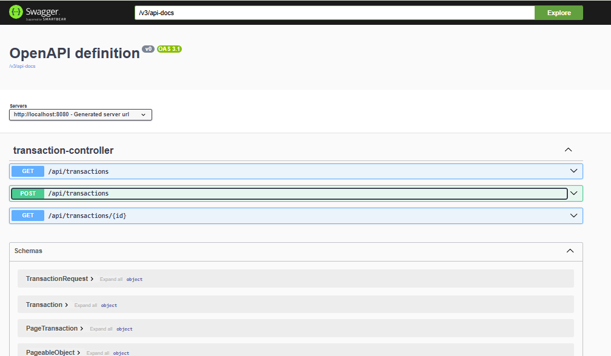
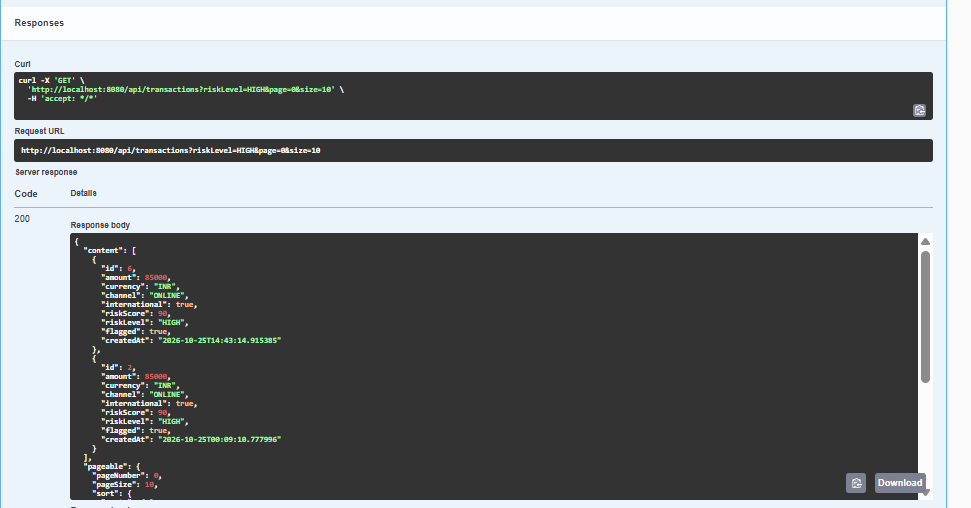
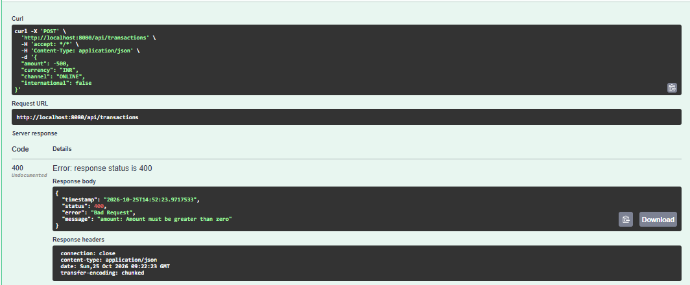

# Transaction Risk Engine


A backend REST API built using **Java 17 and Spring Boot** to process financial transactions, calculate risk scores, classify transactions into risk levels, and automatically flag potentially risky transactions.

The application provides RESTful APIs, database persistence using MySQL, advanced filtering, pagination, sorting, request validation, and structured error handling. It is containerized using Docker and Docker Compose.

## Key Features

- Create and persist financial transactions
- Rule-based transaction risk scoring
- Automatic LOW, MEDIUM, and HIGH risk classification
- Automatic flagging of high-risk transactions
- Retrieve individual transactions by ID
- Advanced filtering by risk level, channel, currency, amount, international status, and transaction date
- Pagination and sorting
- Request validation and structured API error responses
- REST API documentation using Swagger / OpenAPI
- Unit and integration testing
- Dockerized application with MySQL
- Environment-based database credentials
- Automated build and test execution using GitHub Actions

## Technology Stack

| Category | Technologies |
|---|---|
| Language | Java 17 |
| Backend | Spring Boot 3.5.6, Spring Web |
| Persistence | Spring Data JPA, Hibernate |
| Database | MySQL 8 |
| Build Tool | Maven |
| API Documentation | Swagger / OpenAPI |
| Testing | JUnit 5, Mockito, MockMvc, H2 |
| Containerization | Docker, Docker Compose |
| CI/CD | GitHub Actions |

## Risk Scoring Logic

The application calculates transaction risk scores using configurable business-rule logic implemented in the service layer.

| Risk Rule | Score |
|---|---:|
| Transaction amount >= 50,000 | +40 |
| Transaction channel is ONLINE | +20 |
| International transaction | +30 |

### Risk Classification

| Risk Score | Risk Level |
|---|---|
| Below 30 | LOW |
| 30–59 | MEDIUM |
| 60 and above | HIGH |

Transactions classified as HIGH are automatically flagged.

### Example

An international online transaction of INR 85,000 receives:

- Amount rule: +40
- Online channel: +20
- International transaction: +30
- **Total risk score: 90**
- **Risk level: HIGH**
- **Flagged: true**

## API Endpoints

Base URL: `http://localhost:8080`

| HTTP Method | Endpoint | Description |
|---|---|---|
| POST | `/api/transactions` | Create a transaction |
| GET | `/api/transactions` | Retrieve transactions |
| GET | `/api/transactions/{id}` | Retrieve a transaction by ID |

### Filtering, Pagination and Sorting

The transaction listing API supports the following query parameters:

| Parameter | Description |
|---|---|
| `riskLevel` | Filter by LOW, MEDIUM, or HIGH |
| `channel` | Filter by transaction channel |
| `currency` | Filter by currency |
| `minAmount` | Minimum transaction amount |
| `maxAmount` | Maximum transaction amount |
| `international` | Filter by international status |
| `fromDate` | Filter transactions from a date |
| `toDate` | Filter transactions up to a date |
| `page` | Page number |
| `size` | Number of records per page |
| `sort` | Sort field and direction |

Example requests:

```http
GET /api/transactions?riskLevel=HIGH
```

```http
GET /api/transactions?channel=ONLINE&currency=INR
```

```http
GET /api/transactions?minAmount=10000&maxAmount=50000
```

```http
GET /api/transactions?page=0&size=10&sort=amount,desc
```

## Sample API Request

**POST** `/api/transactions`

```json
{
  "amount": 85000,
  "currency": "INR",
  "channel": "ONLINE",
  "international": true
}
```

Expected calculated values:

```json
{
  "riskScore": 90,
  "riskLevel": "HIGH",
  "flagged": true
}
```

*The response also contains the transaction's other fields and generated identifier.*

## Application Architecture

The application follows a layered architecture:

```text
Client / Swagger UI
        |
        v
REST Controller
        |
        v
Service Layer
(Risk Scoring & Business Logic)
        |
        v
Repository Layer
(Spring Data JPA)
        |
        v
MySQL Database
```

Responsibilities:

- **Controller:** Handles HTTP requests and responses.
- **Service:** Implements business logic and risk-scoring rules.
- **Repository:** Handles database operations and transaction filtering.
- **Entity / DTO:** Separates database models from API request and response objects.
- **Exception Handling:** Provides consistent error responses and validation feedback.

## Running the Application with Docker

### Prerequisites

- Docker Desktop
- Docker Compose

### 1. Clone the repository

```bash
git clone https://github.com/Shreyadeshmukh15/transaction-risk-engine.git
cd transaction-risk-engine
```

### 2. Configure environment variables

Create a `.env` file in the project root:

```env
MYSQL_ROOT_PASSWORD=your_secure_password
DB_USERNAME=root
DB_PASSWORD=your_secure_password
```

Use a strong private password. Do not commit `.env` to GitHub.

### 3. Build and start the application

```bash
docker compose up --build -d
```

### 4. Verify running containers

```bash
docker compose ps
```

The application will be available at:

- API: `http://localhost:8080/api/transactions`
- Swagger UI: `http://localhost:8080/swagger-ui/index.html`

MySQL is exposed on host port `3307`.

The database uses a Docker named volume for persistence, so transaction data is retained when containers are stopped and restarted.

## Running Tests

Run the test suite using Maven:

```bash
mvn clean verify
```

The project includes:

- Unit tests using JUnit 5 and Mockito
- Controller tests
- JPA repository integration tests using H2
- API integration tests using MockMvc

## Continuous Integration

GitHub Actions automatically builds the project and runs tests on:

- Pushes to the `main` branch
- Pull requests targeting the `main` branch

The workflow executes:

```bash
mvn -B clean verify
```

## Swagger API Documentation

Swagger UI provides an interactive interface to explore and test the REST endpoints.

After starting the application, visit:

`http://localhost:8080/swagger-ui/index.html`

## Screenshots

### Swagger API Documentation



### High-Risk Transaction



### Validation Error



## Future Enhancements

- MySQL integration testing using Testcontainers
- Configurable risk-scoring rules
- Authentication and authorization using Spring Security
- Improved transaction monitoring and reporting

## Author

**Shreya Deshmukh**

[GitHub](https://github.com/Shreyadeshmukh15) | [Project Repository](https://github.com/Shreyadeshmukh15/transaction-risk-engine)